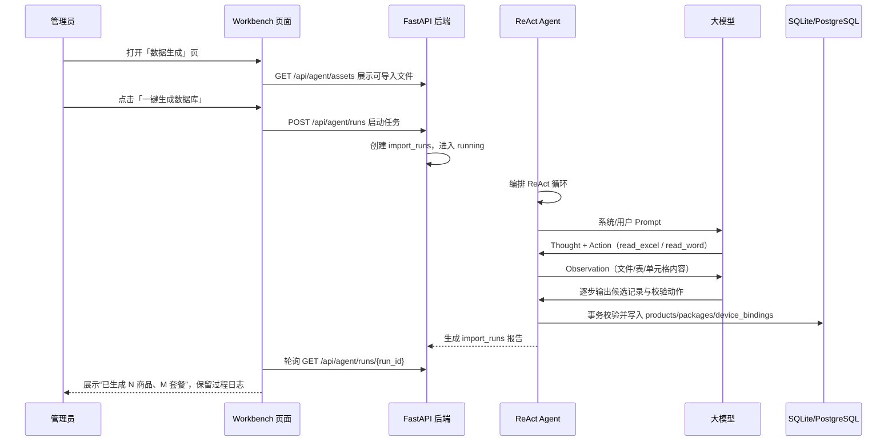

# Workbench 一键生成数据库 Agent（ReAct 数据导入）开发文档

Date: `2026-09-08`
Status: `draft for review`
Related: `docs/aegis/specs/2026-09-04-lan-master-slave-split-design.md`

## 1. 背景与目标

### 1.1 一句话需求

管理员把自己的业务资料（Word、Excel 等，形态不限）放进 `assets` 目录，登录 Workbench 后点击一个「一键生成数据库」按钮；后端启动一个严格按 **ReAct（Reasoning + Acting）** 范式运行的 Agent，把预写好的 Prompt 发给大模型，由大模型通过工具函数读取资料并提取信息，整理成 Workbench 规范化数据库结构后写入数据库。

### 1.2 现状

Workbench 已有一套稳定、规范化的数据库结构，是 Quote 报价端的唯一数据权威源：

- `users`：工作台账号。
- `products`：商品（设备 + 耗材统一表，`category` 区分 `device` / `consumable`）。
- `packages`：套餐定义，SKU 明细以 JSON 存储。
- `device_bindings`：设备-耗材绑定。
- `app_settings`：公司信息与报价参数。
- `app_versions`：客户端版本信息。

现有录入方式是管理员在「设备管理 / 耗材管理 / 套餐管理」中手工逐条新增。仓库根目录已有原始业务资料样例，例如 `assets/产品最低价格.xlsx`、`assets/超声医疗报价平台业务文档.md`，但尚无自动识别、转换、入库链路。

### 1.3 目标

- 提供一个「源资料目录」：用户把任意来源的 Word / Excel 等资料放进去。
- Workbench 新增「数据生成」页面，提供一键生成数据库按钮。
- Agent 按固定 Prompt + ReAct 循环执行：Thought → Action（调用读 Excel / Word 等工具）→ Observation → 继续或结束。
- Agent 最终产出符合 Workbench 规范 JSON 的 `products`、`packages`、`device_bindings` 候选数据。
- 校验通过后写入现有数据库表，并返回执行过程、统计结果与问题清单。
- 一期工具集只读，模型不允许直接写库；Agent 的写库动作由受控的 `apply` 步骤执行。

### 1.4 核心约束

1. **不改现有表结构**，与项目基线一致：沿用新增表方式扩展运行日志。
2. **报价端兼容不回退**：现有 `/api/products*`、`/api/packages*`、`/api/catalog`、`/api/sync` 的契约必须保持。
3. **写库前必须校验**：SKU 唯一、`category` 合法、价格可转数字、套餐 SKU/数量 JSON 等规则不能由模型绕过。
4. **可观测**：ReAct 每一步都应记录在服务端运行任务中，管理员可在页面看到进度和结果。
5. **失败可回看**：生成任务保留报告；入库使用事务，失败不留下半成品。

## 2. 术语与边界

| 术语 | 含义 |
| --- | --- |
| `assets` | 用户原始资料目录。开发态 = 仓库根 `assets/`；打包态 = `%APPDATA%\HHZ\assets/`，通过 `ASSETS_DIR` 配置 |
| Agent | 后端长期运行的任务编排器 + Prompt 循环，不指某个具体聊天产品 |
| ReAct | 模型循环输出 Thought / Action，执行工具得到 Observation 后继续，直到可结束 |
| 规范 JSON | 只包含 Workbench 模型允许的字段与合法值，如 `product.category` 属于 `device` / `consumable` |
| 候选记录 | Agent 提取、尚未提交的数据；存于 `import_candidates` 表或临时 JSON |
| Dry-run | 只生成候选和报告，不写正式业务表，用于验收和演示 |
| Apply | 经过校验后把候选事务式写入正式业务表 |

## 3. 使用流程

### 3.1 典型场景

管理员收到一批旧价格表、Word 业务说明或 Excel 报价底账，希望不必逐行录入 Workbench，而是把文件放入 assets，点击一次按钮让 Agent 生成规范化数据库。



### 3.2 一键按钮后的阶段

1. `inventory`：扫描 assets 目录，生成支持/不支持文件清单。
2. `plan`：根据 Prompt 决定哪些文件、哪些 sheet / 段落最相关。
3. `extract`：按需调用读 Excel / Word 工具，逐块获得结构化 Observation。
4. `map`：把原始字段映射到 Workbench 规范化 JSON（例如 Excel 的「最低价」→ `min_price`）。
5. `verify`：服务端校验引用完整性、价格/数量/唯一性；必要时让模型修复。
6. `apply`：以事务写入正式表；成功 commit，失败 rollback。
7. `report`：记录统计、跳过项、告警与 ReAct 轨迹。

### 3.3 一键生成与数据安全

第一版定位为「一键自动生成」，因此 Apply 阶段不再弹确认框；设计上保留两个安全阀：

- 环境变量 `AGENT_DEFAULT_MODE=dry-run|apply`，默认 `apply`；测试/演示时可切 `dry-run`。
- 页面始终展示本次运行报告；运行完成后可再次运行同一批 assets，冲突策略由 Prompt + 服务端校验层共同决定。

## 4. 资产目录与文件支持

### 4.1 assets 路径规则

在 `Workbench/app/core/config.py` 新增配置：

| 配置 | 开发默认 | 打包 exe 时 |
| --- | --- | --- |
| `assets_dir` / `ASSETS_DIR` | `../assets`（仓库根 `HHZ/assets/`） | `%APPDATA%\HHZ\assets/`（`entry.apply_env()` 注入并自动创建） |

规则：

- 只扫描 `assets_dir` 根下的文件与一级子目录，避免无限递归。
- 扩展名白名单一期为 `.xlsx`、`.docx`、`.csv`、`.md`；兼容层再考虑 `.xls`、`.doc`。
- 非白名单文件进入“不支持”清单，不阻塞任务；文件损坏或加密时报告问题。
- 文件按修改时间 + SHA-256 识别版本，内容变化后重新提取。

### 4.2 一期读取工具

Agent 工具注册表一期包含「阅读 Excel 和 Word」的函数：

| 工具名 | 输入 | 输出 | 用途 |
| --- | --- | --- | --- |
| `list_assets` | 可选：目录相对路径 | 文件清单（path / type / size / mtime / sha256） | 让模型知道可读什么 |
| `read_excel` | `path`、可选 `sheet`、可选 `range`、可选 `headers_row` | sheet 列表、表头、单元格预览、行数、字段类型样例 | 读 `产品最低价格.xlsx` 等多表 Excel |
| `read_word` | `path`、可选段落范围 | 段落文本、表格结构、标题层级 | 读 Word 业务文档/说明 |
| `search_text` | `path`、关键词 | 命中位置与上下文 | 定位大文档中的关键业务段 |
| `report_issue` | 描述 | 记录问题 | 对模型无法消歧/缺失字段提出告警 |

### 4.3 解析引擎建议

后端不要手写 XML，使用成熟库：

- `.xlsx`：`openpyxl`；`.xls`：`xlrd`（或按需引入）。
- `.docx`：`python-docx`；`.doc`：Windows 打包机可选的 Word COM / 转换工具，属于后续兼容项。
- `.csv`：Python `csv`；`.md`：按标题/表格做轻量结构化读取。

`Workbench/requirements.txt` 增加 `openpyxl`、`python-docx` 等依赖，并在 PyInstaller hiddenimports 中登记，避免 exe 漏打包。

### 4.4 Observation 截断策略

- 大 Excel 默认只输出：sheet 名、列名、前 3–5 行、总行数；模型需要更多数据时再按 `range` 分页读取。
- Word 默认只输出标题树和段落/表格数量；需要细节时按范围读取。
- 所有 Observation 标记 `truncated: true/false`，避免一次把超大文件塞进模型造成超时/超长。
- 原始文件正文不落业务库；仅在运行报告中保留必要摘录，默认不开启全文留痕。

## 5. 规范化目标结构

Agent 的 Prompt 必须把下列目标结构作为唯一可写格式，不允许发明字段或新增隐式表。

### 5.1 product（产品）

| 字段 | 约束 | 常见资料对应 |
| --- | --- | --- |
| `sku_id` | 非空、唯一；生成规则沿用 `P/C + 3 位序号` | 表格“编号/SKU” |
| `category` | 只允许 `device` / `consumable` | “类型/设备/耗材”或表格位置 |
| `name` | 非空 | 产品名称 |
| `min_price` | 数字或空 | “最低价/底价” |
| `max_price` | 数字或空 | “最高价/市场价” |
| `unit` | 文本或空 | “台/袋/瓶/盒” |
| `pieces_per_unit` | 整数或空 | 每单位件数 |
| `units_per_box` | 整数或空 | 每箱单位数 |
| `box_price` | 数字或空 | 箱价 |
| `applicable_devices` | 文本或空 | 适用设备说明 |
| `raw_price_desc` | 文本或空 | 价格口径原文 |
| `remark` | 文本或空 | 备注 |
| `image` | 文本或空 | 本阶段不自动找图，保持空 |

示例 JSON：

```json
{
  "sku_id": "P001",
  "category": "device",
  "name": "超声波治疗仪CSY-200（台式）",
  "min_price": 2500,
  "max_price": null,
  "unit": "台",
  "pieces_per_unit": null,
  "units_per_box": null,
  "box_price": null,
  "applicable_devices": null,
  "raw_price_desc": "来源于产品最低价格.xlsx SKU主表",
  "remark": null
}
```

### 5.2 device_binding（设备-耗材绑定）

| 字段 | 约束 |
| --- | --- |
| `device_sku_id` | 必须存在且 `category=device` |
| `consumable_sku_id` | 必须存在且 `category=consumable` |

常见来源：

- Excel「适用设备」列，如某耗材适用于多台设备。
- 套餐定义表“设备 + 耗材组合”隐含的适用关系。
- Word 业务说明中“只能搭配某设备/耗材”的规则。

### 5.3 package（套餐）

| 字段 | 约束 | 常见资料对应 |
| --- | --- | --- |
| `package_id` | 非空、唯一；沿用 `PKG + 3 位序号` | 套餐编号 |
| `name` | 非空 | 套餐名称 |
| `sku_ids` | 非空 JSON 数组 | 套餐内 SKU |
| `quantities` | JSON 数组，长度与 `sku_ids` 一致 | 每个 SKU 数量 |
| `std_price` | 数字或空 | 标准价 |
| `discount_price` | 数字或空 | 折扣价 |
| `discount_rate` | 文本或空 | 折扣率 |
| `device_qty` | 整数或空 | 设备台数 |
| `consumable_qty` | 整数或空 | 耗材数量 |
| `consumable_boxes` | 整数或空 | 耗材箱数 |
| `fixed_bundle` | `0/1` | 是否固定整购 |
| `device_price` | 数字或空 | 套餐内设备价 |
| `note` | 文本或空 | 套餐说明 |

示例 JSON：

```json
{
  "package_id": "PKG001",
  "name": "超声治疗（台式）推广套餐",
  "sku_ids": ["P001", "C004", "C012"],
  "quantities": [1, 1200, 0],
  "std_price": 6000,
  "fixed_bundle": 0,
  "device_price": null,
  "note": "买2箱耗材送1台台式设备"
}
```

注意：`fixed_bundle` 和“赠机/推广”语义不能由模型自由解释，Prompt 必须给出业务规则示例；歧义时调用 `report_issue`。

## 6. Agent 架构

### 6.1 模块划分

建议新增独立目录，不把 Agent 逻辑堆进 `compat/`：

```text
Workbench/app/
├── agent/
│   ├── __init__.py
│   ├── schemas.py            # ReAct/工具/候选/运行的 Pydantic 模型
│   ├── prompts.py            # 系统 Prompt + 用户 Prompt 模板 + 目标 schema 序列化
│   ├── llm_client.py         # OpenAI 兼容客户端抽象
│   ├── tool_registry.py      # 工具注册与执行器
│   ├── readers/
│   │   ├── manifest.py       # assets 清单
│   │   ├── excel_reader.py   # read_excel
│   │   └── word_reader.py    # read_word
│   ├── validation.py         # 非 LLM 的服务端硬校验
│   ├── persistence.py        # 候选暂存 + 事务入库
│   └── agent_service.py      # ReAct 主循环、状态机、报告
├── api/v1/agent.py           # 新增 API 路由
```

依赖方向：

```text
api -> agent_service -> (tool_registry + llm_client + validation + persistence)
```

`agent_service` 不依赖 `compat` 中的 HTTP handler，只调用可复用的 service/ORM 能力，避免环依赖。

### 6.2 ReAct 循环伪代码

```text
def run_agent(run, mode):
    step = 0
    set_status(run, "running")
    user_prompt = build_user_prompt(run, assets)
    messages = [system_prompt(), user_prompt]

    while step < max_steps and not done:
        response = llm.chat(messages, tools=TOOL_SCHEMAS)
        save_trace(run, response)

        if response.finish:
            final = validate_candidates(response.candidates)
            break

        if response.tool_calls:
            for call in response.tool_calls:
                observation = tool_registry.execute(call.name, call.args, run)
                messages.append(tool_message(call.id, observation))
        else:
            observation = report_issue("Agent 未选择工具或未结束")
            messages.append(tool_message(None, observation))
        step += 1

    validated, errors = validation.validate(final.candidates, db)
    report = persistence.apply(validated, mode=mode, run=run)
    finish_run(run, report)
```

关键点：

- Thought 只要求输出简短的“当前判断/下一步依据”，不要求模型输出冗长内部思考链。
- Action 必须对应工具 schema；Observation 是工具执行结果，不由模型自行编造。
- 执行器只允许读取 assets 白名单内的文件。
- 终止条件为模型提交 `finish` 且候选通过服务端校验、达到 `max_steps`、用户取消，或出现不可恢复错误。

### 6.3 LLM 适配层

对接 OpenAI 兼容的 Chat Completions `tools` / `tool_calls` 协议。配置通过 `.env` 注入，不写死：

| 环境变量 | 说明 |
| --- | --- |
| `LLM_BASE_URL` | 例如 `https://api.openai.com/v1` 或企业网关 |
| `LLM_API_KEY` | 密钥 |
| `LLM_MODEL` | 模型名 |
| `LLM_MAX_STEPS` | 单任务最大循环步数，默认 20 |
| `AGENT_DEFAULT_MODE` | `dry-run` / `apply` |

生产首次交付前使用具备函数调用能力的模型验证；开发时允许 `mock` provider 返回预置候选，保证离线可测。

### 6.4 大模型不直接写库

ReAct 工具分为两类：

1. 只读工具：`list_assets`、`read_excel`、`read_word`、`search_text`、`lookup_existing`。
2. 受控输出工具：`propose_candidates`（模型产候选 JSON）、`finish`（提交候选）、`report_issue`。

`propose_candidates` 输出进入 staging，只有服务端 `validation + persistence` 才能调用 ORM 写正式表。

### 6.5 候选格式

模型在最后用 `propose_candidates` 返回：

```json
{
  "products": [],
  "packages": [],
  "bindings": [
    {"device_sku_id": "P001", "consumable_sku_id": "C004"}
  ],
  "issues": ["未找到 P013 的最低单价，保持空"]
}
```

服务端不接受自由文本式“字段乱写”，对模型输出做硬校验：

- 字段白名单：未知字段丢弃或报错。
- 类型强转：复用 `to_number` / `to_int` 语义。
- 引用完整性：套餐 SKU 必须已在 products 候选或现有库中。
- 数组长度：`quantities` 与 `sku_ids` 一致。
- 重复检测：与现有库比对，按冲突策略处理。

## 7. 冲突与更新策略

一键生成需要处理“重复运行”和“现有库已有数据”。

建议默认策略：

| 场景 | 默认动作 | 原因 |
| --- | --- | --- |
| SKU 不存在 | 新增 | 自动生成 |
| SKU 已存在且资料值一致 | 跳过，不改 | 避免无意义更新时间戳 |
| SKU 已存在且资料值不同 | 更新非空字段；空字段不覆盖旧值 | 以最新资产为准，保留旧备注/图片 |
| `sku_id` 冲突但名称明显不同 | `report_issue` 并跳过 | 避免把不同商品错误合并 |
| `package_id` 已存在 | 同 SKU 策略 | 套餐需要整体校验 |

冲突策略先做常量配置（`overwrite: auto` / `skip`），不做页面复杂设置；第一版不删除现有数据。

## 8. 新增持久化表

沿用“只新增表”的 Aegis 基线，为可观测和审计新增三张表（不改动现有业务表）：

### 8.1 `import_runs`

| 字段 | 说明 |
| --- | --- |
| `id` | 主键 |
| `mode` | `dry-run` / `apply` |
| `status` | `running / succeeded / failed / cancelled` |
| `file_count`、`products_added` 等 | 结果摘要 |
| `started_at` / `finished_at` | 时间 |
| `error` | 失败信息 |

### 8.2 `import_run_events`

记录 ReAct 轨迹：step、role、tool、summary、created_at。默认不存大模型全量原始工具大文本，详情写服务端日志目录并按需清理。

### 8.3 `import_candidates`（可选）

Apply 前暂存候选 JSON；也可以只在运行目录落 JSON，避免表膨胀。若采用表结构，字段为 `run_id`、`entity_type`、`payload_json`、`status`、`validation_errors`。

## 9. API 设计

全部走现有统一响应结构 `{code, message, data}`，放在 `/api/agent` 前缀，登录保护（`Depends(require_user)`）。

| 方法 | 路径 | 说明 |
| --- | --- | --- |
| GET | `/api/agent/assets` | 列出 assets 文件与支持状态 |
| GET | `/api/agent/assets/status` | 文件哈希/修改时间变化提示 |
| POST | `/api/agent/runs` | 一键创建并启动 Agent（Body：可选 `mode`；缺省按配置） |
| GET | `/api/agent/runs/{run_id}` | 运行状态、阶段、步骤事件、统计 |
| POST | `/api/agent/runs/{run_id}/cancel` | 取消进行中的任务 |
| POST | `/api/agent/runs/{run_id}/retry` | 用同一批 assets 重新运行 |
| GET | `/api/agent/runs` | 历史运行列表 |

`POST /api/agent/runs` 请求示例：

```json
{
  "mode": "apply",
  "note": "初始资料导入"
}
```

响应立即返回 `run_id`，Agent 在后台执行；前端轮询，不在一次同步请求中等待整轮 ReAct。

## 10. 工作台前端改动

### 10.1 入口

- 侧边栏新增「数据生成」，路由 `/workbench/agent`。
- 页面沿用现有 Workbench 设计体系：管理型页面、紧凑布局、图标按钮，不引入营销风格。

### 10.2 页面内容

建议三块：

1. 源文件区：展示 `assets` 文件清单、格式支持状态、修改时间；“刷新”按钮。
2. 一键操作区：主按钮「一键生成数据库」；运行中展示阶段和最近步骤，可取消。
3. 运行报告区：历史运行列表；点击查看新增、跳过、问题清单和错误详情。

### 10.3 轮询与状态

- `api.agent.listAssets()`、`api.agent.startRun()`、`api.agent.getRun()`、`api.agent.cancelRun()` 等按现有 `workbenchClient.js` 风格添加。
- 启动后每 1–2 秒 `GET /api/agent/runs/{id}`，状态进入 `succeeded / failed / cancelled` 后停止。
- 按钮点击后锁定，运行完成后恢复；页面刷新不丢任务，以后端 run 记录为准。

## 11. Prompt 设计规格

### 11.1 系统 Prompt 固定内容

1. 角色：你是 Workbench 数据库生成 Agent。
2. 目标：只从 assets 提取资料并整理为规范化 JSON。
3. 目标 schema：见第 5 节，由服务端序列化注入，不得新增字段。
4. 业务规则：
   - 设备 `category=device`，耗材 `category=consumable`。
   - `min_price` 是报价下限；资料中的“成本/折扣/旧挂牌价”不能随意写进 `min_price`。
   - 单位、每箱数必须带可追溯口径；拿不准时置空并 `report_issue`。
   - 套餐 `sku_ids` / `quantities` 长度一致；引用不到的产品不能创建虚拟 SKU。
   - 设备-耗材绑定只依据“适用设备/适用耗材/套餐定义”，不能推测。
5. 行为约束：
   - 每一步先 Thought，再选工具。
   - 一次不要读取超大范围；Observation 被截断时缩小查询。
   - 只有真正读到的内容可以进入候选；未读到的写 `report_issue`。
   - 不得从 Prompt 自带示例中抄袭商品；示例仅说明字段格式。
   - 结束前调用 `propose_candidates`，然后 `finish`。

### 11.2 用户 Prompt 动态内容

由服务端生成：

```text
assets 清单：{文件清单 JSON}
现有库统计：{产品数、套餐数、SKU 前缀计数}
冲突策略：{新增/更新/跳过}
请按系统目标 schema 生成候选 JSON。
```

模板保留版本号 `PROMPT_VERSION`，写入 run 记录，便于后续 Prompt 变更回溯。

### 11.3 输出协议

推荐使用原生 `tools` 协议；若需要显式 JSON 文本，字段固定为：

```json
{
  "thought": "该 Excel 含 SKU主表，先读表头与前三行判断列名",
  "action": "read_excel",
  "action_input": {"path": "产品最低价格.xlsx", "sheet": "SKU主表", "max_rows": 5}
}
```

Observation 由服务端返回：

```json
{
  "ok": true,
  "sheet": "SKU主表",
  "headers": ["类型", "SKU", "名称", "最低价"],
  "sample_rows": [],
  "row_count": 25,
  "truncated": true
}
```

## 12. 安全与数据边界

1. assets 沙箱：工具只能读 `assets_dir` 解析后的真实路径，禁止 `../` 越界。
2. 密钥管理：`LLM_API_KEY` 只在后端进程环境，不返回前端。
3. 隐私：发送给模型的内容仅限需要提取的资料；业务库只存规范化数据和必要来源摘要。
4. 只读语义：除受控 `apply` 外，Agent 无其它写库入口；图片仍走原 `/uploads`。
5. 失败不污染：正式写入使用单个事务；任一条失败整批回滚，报告原因。
6. 网络边界：无外网环境需配置可访问的企业模型网关；离线只能用 `mock` 或确定性规则模式。

## 13. 验收标准

使用仓库现有 `assets/产品最低价格.xlsx`（含 SKU主表、套餐定义表）作为基准样例：

1. assets 中放入文件后，Workbench「数据生成」页能列出文件、类型与可导入状态。
2. 点击「一键生成数据库」创建 run，页面能看到 running 和 ReAct 步骤更新，无需刷新。
3. 生成结果满足：
   - 产品数覆盖 SKU主表中有名称的行，设备/耗材类别正确。
   - `sku_id` 不与现有库重复；重复场景按冲突策略执行。
   - 套餐记录来自套餐定义表，SKU 明细引用均已存在。
   - 绑定行依据“适用设备/套餐定义”生成，无无中生有的绑定。
4. 故意放错字段（如“市场价”被写成最低价）触发 `report_issue`，而不是静默入库。
5. 运行失败、取消或某条校验失败时，正式业务表无部分写入。
6. 回归：Agent 完成后 `/api/products`、`/api/packages`、`/api/sync` 响应仍符合旧契约。
7. 用 `AGENT_DEFAULT_MODE=dry-run` 再跑一次：只出现候选和报告，正式表行数不变。
8. exe 打包后 `%APPDATA%\HHZ\assets` 自动创建，放入 `.docx` 文件能被 `read_word` 正常读取。

## 14. 风险与对策

| 风险 | 对策 |
| --- | --- |
| 大模型把“低价表”误读为“建议价” | Prompt 固定业务口径 + 服务端字段校验 + report_issue；不通过不入库 |
| Excel 多 sheet / Word 长文超上下文 | 只返回预览；按 range 分页读取；Observation 带截断标记 |
| 模型幻觉生成不存在 SKU | 引用完整性硬校验；未入库前必须匹配候选/现有库 |
| 重复运行导致脏数据 | 冲突策略 + 唯一约束 + 事务；先 dry-run 验收 |
| 一次运行过长、误点击 | 后台任务 + 取消接口 + max_steps |
| 新依赖未打进 exe | PyInstaller hiddenimports 登记；打包验收覆盖 docx/xlsx |
| API Key 外泄 | 环境变量只读、不落库不落日志 |
| 现有表约束被绕过 | 写库必须走服务端校验器，不使用模型自拼 SQL |

## 15. 实施顺序建议

- **P0 资产与读取**：`assets_dir` 配置、目录扫描、文件清单 API、Excel/Word 读取器和单元测试。
- **P1 Agent 壳**：run 表 + 事件表、LLM 客户端、工具注册表、ReAct 主循环、dry-run 报告。
- **P2 规范化与入库**：候选 JSON、硬校验、冲突策略、事务 Apply。
- **P3 前端一键**：数据生成页、一键按钮、轮询/取消/历史报告、workbench API client。
- **P4 加固与打包**：文件大小限制、取消/超时、日志轮转、requirements/hiddenimports、exe 验证。
- **P5 回归**：现有 assets 样例端到端测试 + 旧接口兼容回归。

## 16. 非目标（本版本不做）

- 不做图片识别/自动找产品图。
- 不做自定义字段/自动改表结构。
- 不做 PDF、扫描件、语音等多模态导入（后续可扩展工具）。
- 不做多用户同时运行同一台主设备的并发写（首个版本单任务队列，页面提示已有运行）。
- 不做删除或全量重建数据库；只新增/更新。
- 不做模型在 Quote 客户机的调用，Agent 仅属于 Workbench 主系统。
