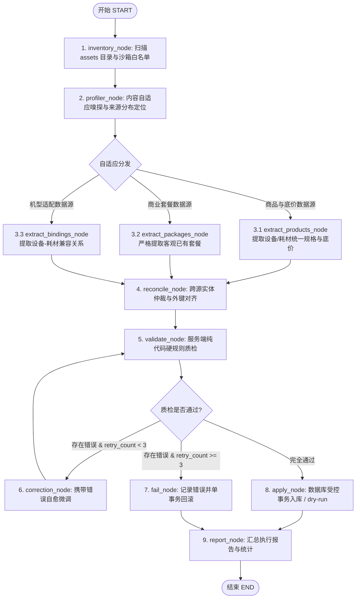

# Workbench 一键生成数据库 Agent（LangGraph 重构）开发规范文档

- 日期：`2026-09-12`
- 状态：`draft for review`
- 适用系统：`Workbench 主系统（FastAPI / SQLite / Windows 服务）`
- 关联基线：`docs/aegis/specs/2026-09-08-workbench-db-generator-agent-design.md`
- 架构演进：从单 ReAct 循环演进为基于 **LangGraph** 的多专职节点有向状态图

---

## 1. 背景与重构动因

### 1.1 现有架构局限
在基线版本中，Workbench 的「一键生成数据库」采用单一大模型的 ReAct（Thought $\rightarrow$ Action $\rightarrow$ Observation）循环。实际运行中遇到三大核心痛点：
1. **职责过载与上下文拥挤**：单模型在同一提示词上下文中既要读表格、又要分析业务文本，还要推导套餐和纠错，极其容易产生幻觉、混淆字段或遗漏重要口径。
2. **资料形态多样难以机械适配**：用户的业务资料形态不可预测——有的集中在单个多 Sheet 的 Excel 中，有的是一整篇图文 Word 说明，有的甚至只是便签里随手写下的几段话。固定针对某种文件后缀的规则无法自适应。
3. **缺乏状态恢复与容错闭环**：单线程循环一旦发生网络中断或部分提取错误，没有快照持久化机制，容易陷入无意义的循环或超时失败。

### 1.2 重构目标
1. **采用 LangGraph 有向状态图架构**：将单 ReAct 拆解为“先嗅探（Profiler）、后专职提取（Extractors）、再仲裁对齐（Reconcile）、纯代码硬质检（Validate）、定向自愈循环（Correction）、受控单事务落库（Apply）”。
2. **自适应内容嗅探（Profiler）**：先探查资产特征与内容分布，根据实际内容定位数据块，而非机械绑定文件后缀。
3. **商业套餐严格防发散红线**：专职套餐节点**仅客观提取资料中现有的商业套餐与买赠规则，严禁主观延伸、推测或发明新套餐**。
4. **完全离线自治**：显式关闭 LangSmith 外部遥测（`LANGSMITH_TRACING=false`），使用本地 SQLite 文件持久化检查点，确保在无外网的单机托盘服务（exe）中稳定运行。
5. **系统与前端零破损兼容**：
   - 维持既有数据库表（`products`, `packages`, `device_bindings`, `import_runs`, `import_run_events`）完全不变。
   - 节点事件实时广播写入 `import_run_events` 表，工作台前端 `AgentManager.vue` 界面无需修改任何代码即可正常展示进度与报告。
   - 保留标准 OpenAI 兼容接口，并升级确定性 `MockProvider`，保证开发测试在无 Key、离线状态下 100% 跑通。

---

## 2. 核心架构与状态机模型

### 2.1 全局图状态（`AgentGraphState`）

系统所有节点均围绕该强类型全局状态运行，支持切片更新与流水线追加：

```python
# Workbench/app/agent/graph/state.py
from typing import TypedDict, Annotated, Optional
import operator

class AgentGraphState(TypedDict):
    # 1. 基础任务上下文
    run_id: int
    mode: str                         # "dry-run"（预演校验） | "apply"（真实落库）
    manifest: dict                    # assets 目录扫描元数据（文件、大小、哈希）
    db_stats: dict                    # 现有库基线统计（产品数、套餐数等）

    # 2. 嗅探规划结果（数据源具体定位映射）
    sources_plan: dict                # {"products": [...], "packages": [...], "bindings": [...]}

    # 3. 专职节点提取切片
    products_extracted: list[dict]    # 设备与耗材基础属性、底价、箱规
    packages_extracted: list[dict]    # 客观提取到的商业套餐与买赠方案
    bindings_extracted: list[dict]    # 设备-耗材兼容配对
    issues: Annotated[list[str], operator.add]  # 业务告警与存疑说明（列表累加）

    # 4. 仲裁与规范化候选数据集
    candidates: Optional[dict]        # {"products": [], "packages": [], "bindings": [], "issues": []}

    # 5. 服务端质检门禁与自愈控制
    validation_errors: list[str]      # 服务端纯代码质检错误列表
    retry_count: int                  # 当前微调轮数（硬上限 3 次）
    status: str                       # "running" | "succeeded" | "failed" | "cancelled"
```

---

### 2.2 状态图拓扑流向（StateGraph Topology）



---

## 3. 多形态资料自适应嗅探（Profiler）机制

### 3.1 覆盖形态
- **单 Excel 多 Sheet**：例如 `产品最低价格.xlsx` 中分别包含 SKU 表、套餐表、适用机型表。
- **单 Word / Markdown**：一份图文说明，正文中包含产品表，文末段落陈述买赠方案。
- **散装口语化段落**：便签或文本文件，仅有几行陈述。
- **混合多文件**：同时放入多个不同来源的表格与说明文件。

### 3.2 嗅探探测规则
`profiler_node` 仅执行轻量探测（读 sheet 名、首行表头、标题大纲、前 20 行文本样本），不进行全量抽取：
1. **商品特征识别**：命中 `sku_id`、`编号`、`规格`、`最低价`、`底价`、`单位`、`每箱` 等字段。
2. **套餐特征识别**：命中 `套餐`、`促销`、`赠机`、`满赠`、`买X赠Y`、`整购` 等字段。
3. **绑定特征识别**：命中 `适用设备`、`适用机型`、`搭配`、`专用` 等字段。

### 3.3 嗅探输出 `sources_plan` 样例
```json
{
  "products": [
    {"file": "产品最低价格.xlsx", "type": "excel", "locator": {"sheet": "SKU主表"}}
  ],
  "packages": [
    {"file": "超声医疗报价平台业务文档.md", "type": "markdown", "locator": {"section": "5.3 报价计算", "is_table": false}}
  ],
  "bindings": [
    {"file": "产品最低价格.xlsx", "type": "excel", "locator": {"sheet": "SKU主表", "column": "适用设备"}}
  ]
}
```
> **兜底防发散机制**：若嗅探器未在资料中发现任何与“套餐/促销/买赠”相关的词汇或段落，`sources_plan["packages"]` 置为空列表，后续直接跳过套餐提取，绝不在没有资料依据的情况下让大模型自发联想。

---

## 4. 专职节点定义与业务红线规范

### 4.1 `extract_products_node`（商品与价格底线）
* **提取字段**：`sku_id`、`category`（`device` 或 `consumable`）、`name`、`min_price`、`max_price`、`unit`、`pieces_per_unit`、`units_per_box`、`box_price`、`raw_price_desc`、`remark`。
* **业务约束**：
  * 设备与耗材不可混淆；
  * `min_price` 必须是真实的底价红线；无底价时保持空，严禁将零售价填入底价。

### 4.2 `extract_packages_node`（商业套餐专职 —— 严禁发散红线）
* **职责**：从 `sources_plan["packages"]` 指定的表格或段落中抽取已有套餐。
* **业务红线（防发散规则）**：
  1. **禁止虚构**：大模型仅被授权作为“已有信息转写器”，严禁根据已有的设备和耗材列表自行设计或组合新套餐。
  2. **区分套餐形态**：
     - **固定整购型（`fixed_bundle=1`）**：整套采购，展开其所包含的全部 SKU 明细和数量。
     - **买赠/推广型（`fixed_bundle=0`）**：例如“买 2 箱贴片送 1 台台式超声仪”，明确解析出起购箱数（`consumable_boxes`）与赠机数量（`device_qty`），并在 `note` 中附带原文依据。
  3. **空置原则**：若资料未明确提及套餐，输出必须为空数组 `[]`。

### 4.3 `extract_bindings_node`（设备-耗材兼容）
* **职责**：提取 `device_sku_id` 与 `consumable_sku_id` 的配对关系，确保报价端只允许合法组合。

### 4.4 `reconcile_node`（实体仲裁与外键对齐）
* **职责**：解决多源文档之间的表述不一致（如自然语言中写“CSY-200 台式机”，实际产品表中为 `P001 超声波治疗仪CSY-200（台式）`）。对齐外键，剔除无效的孤儿 SKU，将疑问记录入 `issues`。

---

## 5. 质检门禁、自愈闭环与受控落库

### 5.1 `validate_node`（纯代码硬质检门禁）
大模型产出的数据**绝不被信任**，必须通过纯 Python 编写的服务端硬校验（复用现有 [`validation.py`](file:///Users/xiongtianyu/Desktop/HHZ/Workbench/app/agent/validation.py)）：
1. **Schema 结构与类型检查**：校验 Pydantic 模型，价格必须可转换为数字，非法字段自动拦截。
2. **SKU 唯一性与类别不可变**：本批候选 SKU 不得重复，且不得把现有库中的设备篡改为耗材。
3. **套餐引用完整性**：套餐中包含的 `sku_ids` 必须全部在“本批商品”或“现有数据库”中存在，`quantities` 长度严格等长。
4. **绑定规则相容性**：套餐内搭配的耗材必须符合设备已有的绑定限制。

### 5.2 `correction_node`（自愈微调回路）
* **条件边规则**：
  - 若 `validate_node` 抛出错误且 `retry_count < 3`：状态机跳转至 `correction_node`。
  - `correction_node` 仅将精准错误日志（例如：“套餐 PKG001 引用了未定义的 SKU: C999”）和有问题的条目喂给模型，模型针对性修复后递增 `retry_count` 并跳回 `validate_node`。
  - 若重试 3 次仍未通过，任务跳转至 `fail_node`，标记失败并单事务回滚，防止系统死循环。

### 5.3 `apply_node`（受控单事务持久化）
* **权限收敛**：只有质检完全通过，才会由应用层 ORM 开启单事务落库。
* **模式切换**：
  - `dry-run`：仅做比对演练，统计即将新增/更新/跳过的数量，不提交正式数据库。
  - `apply`：单事务写入正式表。同 SKU 且同名更新非空字段；同 SKU 异名跳过并告警防串台；成功一次性 `db.commit()`，异常立即 `db.rollback()`。

---

## 6. 本地离线持久化与环境适配

### 6.1 离线环境与 Checkpointing
* **禁用遥测**：
  ```python
  import os
  os.environ["LANGSMITH_TRACING"] = "false"
  ```
* **本地 SQLite 检查点**：
  状态检查点存储于 `Workbench/data/agent_checkpoints.db`，由 `langgraph.checkpoint.sqlite.SqliteSaver` 驱动，支持任务中断恢复与审计溯源。

### 6.2 确定性离线 Mock 保证
在未配置真实大模型 Key 或无外网的本地开发/测试环境中，系统自动启用升级版的 `MockProvider`。各图节点直接返回预置的合法合规测试数据，保证现有 11 项单元测试与离线演示 100% 正常运行。

---

## 7. 实施路线图与任务分解（Task Breakdown）

| 阶段 | 任务名称 | 核心修改文件 | 验收标准 |
| --- | --- | --- | --- |
| **Task 1** | 依赖引入与离线配置 | `Workbench/requirements.txt`<br/>`Workbench/app/agent/graph/config.py` | 安装 `langgraph`，本地 SQLite 检查点初始化成功，遥测关闭。 |
| **Task 2** | 图状态与自适应嗅探 | `Workbench/app/agent/graph/state.py`<br/>`Workbench/app/agent/graph/nodes/profiler.py` | 准确识别单 Excel 多 Sheet、单 Word 图文及散装段落中的数据源分布。 |
| **Task 3** | 专职提取节点开发 | `Workbench/app/agent/graph/nodes/extractors.py` | 提取商品、已有套餐及绑定；**在无套餐文本输入时严格输出空数组**。 |
| **Task 4** | 仲裁与质检自愈回路 | `Workbench/app/agent/graph/nodes/quality.py` | 服务端硬规则门禁起效，错误自动跳转微调，超过 3 次触发安全熔断。 |
| **Task 5** | 图组装与 AgentService 适配 | `Workbench/app/agent/graph/builder.py`<br/>`Workbench/app/agent/agent_service.py` | 编译 `StateGraph`，驱动执行，向 `import_run_events` 广播事件，前端 UI 零修改无缝对接。 |
| **Task 6** | 回归测试与 E2E 验收 | `Workbench/tests/test_agent.py`<br/>`Workbench/tests/test_agent_langgraph_e2e.py` | 既有 11 项测试 100% 通过；覆盖形态 A/B/C 及防发散端到端验收。 |

---

## 8. 验收与测试用例矩阵

1. **测试用例 1（既有回归契约）**：
   运行 `cd Workbench && .venv/bin/python -m unittest tests.test_agent -v`，确认 11 项测试保持全绿。
2. **测试用例 2（多 Sheet Excel 导入）**：
   准备形态 A 文件，验证 `products`、`packages` 与 `device_bindings` 均能被准确归位并成功导入。
3. **测试用例 3（纯自然语言段落导入）**：
   准备形态 C 文件（一段话描述设备、一段话描述买赠方案），验证能正确解析出 1 台设备、1 种耗材和 1 个买赠套餐。
4. **测试用例 4（套餐防发散严格测试）**：
   仅提供常规设备与耗材价格表（不包含任何套餐字样），验证 Agent 生成的候选数据中 `packages` 长度严格为 0，未出现任何虚构套餐。
5. **测试用例 5（前端实时事件验证）**：
   在浏览器打开工作台 `/workbench/agent`，发起一次任务，验证步骤事件按“扫描 $\rightarrow$ 嗅探 $\rightarrow$ 提取 $\rightarrow$ 质检 $\rightarrow$ 入库”顺序实时展示，报告统计数值准确。
