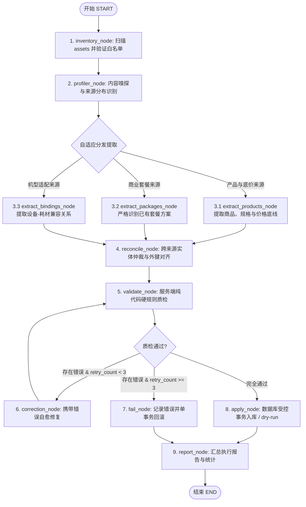

# Workbench 数据生成 Agent 的 LangGraph 重构设计规范

- 日期：`2026-09-12`
- 状态：`draft for review`
- 关联基线：`docs/aegis/specs/2026-09-08-workbench-db-generator-agent-design.md`

---

## 1. 背景与重构目标

### 1.1 现状与痛点
Workbench 原有一套基于单 Agent 纯循环 ReAct 范式的「一键生成数据库」功能（位于 `Workbench/app/agent/`）。在实际业务场景中，该架构面临三大挑战：
1. **职责过载与注意力分散**：单模型在同一上下文中既要读 Excel 价格表，又要读 Word/MD 业务说明，还要推导套餐搭配，容易造成上下文拥挤、格式混淆和幻觉。
2. **资料形态异构不一**：用户的真实业务资料形态多样——可能全部整合在一个包含多个工作表的 Excel 中、可能是一整份图文 Word 文档，也可能仅仅是便签式的几段话描述。单 ReAct 的静态提示词难以自适应识别。
3. **缺乏状态恢复与容错闭环**：单线程 ReAct 一旦在中途步骤发生网络超时或格式错误，缺乏状态快照持久化机制；虽有服务端硬校验，但自愈路径不明确，容易超时空转。

### 1.2 重构目标
- **引入 LangGraph 状态图引擎**：将线性单 ReAct 重构为基于 `StateGraph` 的多专职节点有向图。
- **自适应内容嗅探（Profiler）**：先感知资产结构与内容分布（表格/文本/散装段落），再动态路由提取。
- **商业套餐防发散约束**：明确商业套餐专职节点的业务红线——**仅识别并结构化已有套餐方案，严禁主观延伸或自行发明新套餐**。
- **完全离线自治**：不依赖任何外部云端遥测（关闭 LangSmith 遥测），状态快照使用本地内置 SQLite（`SqliteSaver`）持久化。
- **无缝兼容基线系统**：
  - 维持现有前端界面（`AgentManager.vue`）零修改，事件流水持续同步至 `import_run_events`。
  - 保持现有业务数据库表结构（`products`, `packages`, `device_bindings`, `import_runs` 等）完全不变。
  - 保持标准 OpenAI 兼容接口，并保留离线 `MockProvider` 保障开发和自动化测试 100% 跑通。

---

## 2. 系统核心架构与数据状态

### 2.1 全局图状态（`AgentGraphState`）

```python
from typing import TypedDict, Annotated, Optional
import operator

class AgentGraphState(TypedDict):
    # 基础运行上下文
    run_id: int
    mode: str                         # "dry-run" | "apply"
    manifest: dict                    # assets 文件清单
    db_stats: dict                    # 现有库基线统计
    
    # 内容嗅探结果：各实体所在的具体源位置
    sources_plan: dict                # {"products": [...], "packages": [...], "bindings": [...]}
    
    # 专职节点提取结果
    products_extracted: list[dict]    # 提取出的商品与价格底线
    packages_extracted: list[dict]    # 提取出的客观已有套餐
    bindings_extracted: list[dict]    # 提取出的设备-耗材绑定
    issues: Annotated[list[str], operator.add]  # 业务告警与疑问清单
    
    # 仲裁与整合后候选
    candidates: Optional[dict]        # {"products": [], "packages": [], "bindings": [], "issues": []}
    
    # 质检门禁与自愈控制
    validation_errors: list[str]      # 服务端硬校验错误信息
    retry_count: int                  # 当前自愈修正轮数（上限 3 次）
    status: str                       # "running" | "succeeded" | "failed" | "cancelled"
```

### 2.2 状态图拓扑（StateGraph Topology）



---

## 3. 专职节点职责与业务规则

### 3.1 `inventory_node`（资产索引）
- **职责**：执行沙箱路径检查，过滤 `.xlsx`、`.docx`、`.csv`、`.md` 文件，构建文件清单元数据（路径、SHA-256、修改时间、文件大小）。

### 3.2 `profiler_node`（内容嗅探与规划）
- **职责**：解决资料整合在“一个 Excel 的多 sheet”、“一份完整 Word”或“几段散装话”的问题。
- **动作**：
  - 轻量遍历 Excel sheet 与表头；
  - 读取 Word 标题层级与表格概览；
  - 读取轻量文本/Markdown 前部内容；
  - 产出 `sources_plan`，精准定位商品表、套餐说明及适配规则分别处于何处。

### 3.3 `extract_products_node`（商品与价格底线）
- **职责**：根据 `sources_plan` 定位，提取 `products`。
- **约束**：
  - 严格区分设备（`category=device`）与耗材（`category=consumable`）；
  - `min_price` 必须是真实的报价红线底价；若没有则留空，不可将零售价或成本价虚假填入。

### 3.4 `extract_packages_node`（客观已有套餐识别）
- **职责**：提取商业套餐与促销赠机方案。
- **业务红线（防发散）**：
  1. **禁止虚构与拓展**：仅还原资料中明确提及的套餐（固定整购或买赠方案），严禁根据商品目录随意打包。
  2. **区分套餐形态**：
     - 固定整购（`fixed_bundle=1`）：按套整购，展开所有 SKU 明细。
     - 赠机/推广（`fixed_bundle=0`）：提取起购箱数（`consumable_boxes`）与赠送设备台数（`device_qty`）。
  3. **空置原则**：资料中无套餐描述时返回空列表，不强行编造。

### 3.5 `extract_bindings_node`（适配关系绑定）
- **职责**：从“适用机型”描述或套餐搭配中提取 `(device_sku_id, consumable_sku_id)`，严禁凭空推测。

### 3.6 `reconcile_node`（仲裁与外键对齐）
- **职责**：将文本段落中的口语化设备名称（如“台式治疗仪主机”）精准对齐到 `extract_products_node` 产出的标准 `sku_id`。剔除无效或孤儿外键引用，记录进 `issues`。

### 3.7 `validate_node`（纯代码硬质检门禁）
- **职责**：直接调用服务端已有的 `validation.validate_candidates`：
  - Pydantic 模型 Schema 检查；
  - SKU 唯一性与类别不可变检查；
  - 套餐 SKU 引用完整性与数量数组等长检查；
  - 设备与耗材兼容性检查。
- **质检通过**：进入 `apply_node`；
- **质检失败**：携带详细错误清单输出至 `validation_errors`。

### 3.8 `correction_node`（自愈修复循环）
- **职责**：当质检出现局部错误（如“套餐 PKG001 引用了不存在的 C999”或“数量数组少了一项”）时，仅将错误信息与相关记录送入模型定向修正，递增 `retry_count`，避免全流程重跑。

### 3.9 `apply_node`（受控事务持久化）
- **职责**：
  - `dry-run` 模式：比对现有库，预演统计新增、更新、跳过数量，不写业务表。
  - `apply` 模式：单事务写入 `products`、`packages`、`device_bindings`。同 SKU 同名更新非空字段，异名跳过并告警。成功一次性提交，异常即刻回滚。

---

## 4. 离线自治与环境适配

1. **完全禁用云端遥测**：
   在应用启动时显式设置：
   ```python
   os.environ["LANGSMITH_TRACING"] = "false"
   ```
2. **本地 Checkpointer**：
   使用 `langgraph.checkpoint.sqlite.SqliteSaver`，将状态存放在 `Workbench/data/agent_checkpoints.db`。
3. **OpenAI 兼容与离线 Mock**：
   - 生产/联网模式：对接兼容 OpenAI 规范的本地或网关大模型。
   - 测试/离线模式：升级 `MockProvider`，实现对 Graph 各节点的确定性模拟，保证单元测试独立运行。

---

## 5. 验证与验收标准

1. **单元测试回归**：
   - 重构后的 LangGraph 模块必须跑通 `Workbench/tests/test_agent.py` 全部现有测试用例。
2. **多形态资料测试覆盖**：
   - 验证形态 A（纯 Excel 含套餐表）、形态 B（图文 Word）、形态 C（纯文本便签段落）下的准确识别。
3. **套餐防发散验证**：
   - 在资料未提及任何套餐时，验证 `packages` 输出严格为空，不产生任何虚构套餐。
4. **前端零调整验证**：
   - 运行过程中在 `AgentManager.vue` 界面观察状态机阶段流转、实时步骤日志与最终汇总报告均正常呈现。
